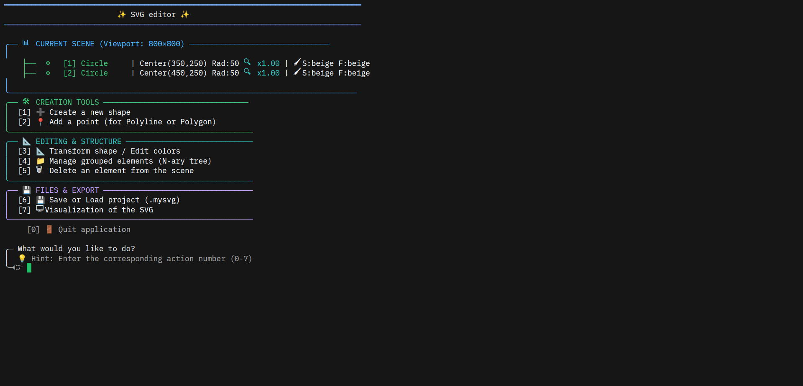

# SVG Editor in C Setup & Guide

A lightweight, terminal-based vector graphics editor and renderer written in C99.



## What it does

- Manages 2D scenes using shapes (Rectangles, Squares, Circles, Ellipses, Lines, Polylines, Polygons)

- Applies cascading transformations (translation, rotation, scaling, and horizontal/vertical flips) across groups

- Saves and loads project state in a custom `.mysvg` format preserving complete node hierarchies and shape IDs

- Exports `.svg` files and launches system viewers (`xdg-open`)

After compiling the project, you can launch the interactive terminal application to create, edit, group, and export vector graphics.

## Instructions

1. Clone or download the project repository to your Linux environment.

2. Open your terminal inside the project directory and compile:

   ```bash
   make clean && make build
   ```

3. Run the application:

   ```bash
   ./editor_svg
   ```

> [!WARNING]
> **Compilation Standards**
>
> The project compiles with strict GCC flags (`-std=c99 -Wall -Werror -Wextra`). Ensure your local compiler supports C99.

> [!NOTE]
> **Missing SVG Viewer Error**
>
> If option `[7] Visualization` outputs an error opening `xdg-open`, ensure a default browser or vector viewer is installed on your Linux desktop environment, or open the generated `render.svg` manually in Chrome/Firefox.

## Usage Steps

1. **Create Shapes (`[1]`)**: Select a shape type and provide dimensions/colors.

2. **Transform (`[3]`)**: Apply moves, rotations, or scaling factors to individual elements or entire groups.

3. **Group Elements (`[4]`)**: Move shapes into groups to organize your N-ary tree hierarchy.

4. **Save/Load (`[6]`)**: Save your work as a `.mysvg` project file or load a previous project.

5. **Export (`[7]`)**: Compile your scene into a `.svg` vector file and view the output.

6. **Enjoy!**

## Visual Results & Comparison

### 1 to 1 real steamhappy and steamhappy using this svg editor

 
